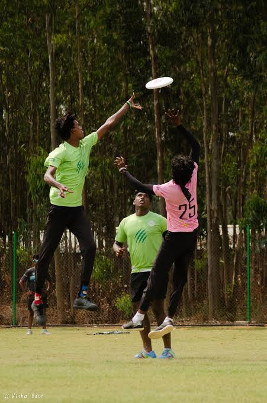

# <!DOCTYPE html>

# <html lang="en">

# <head>

# &#x20;   <meta charset="UTF-8">

# &#x20;   <meta name="viewport" content="width=device-width, initial-scale=1.0">

# 

# &#x20;   <title>Rob Isaac Umbac | My Personal Website</title>

# 

# &#x20;   <link rel="stylesheet" href="MyWebsite/style.css">

# </head>

# 

# <body>

# 

# &#x20;   

# 

# &#x20;       <h1>Welcome to Rob's Personal Website!</h1>

# 

# &#x20;       

# 

# &#x20;       <h2>Rob Isaac Umbac</h2>

# 

# &#x20;       <h3>My Hobby</h3>

# 

# &#x20;       

# 

# &#x20;       

# &#x20;           Hello! My name is Rob Isaac Umbac.

# &#x20;           I am an Information Technology student

# &#x20;           who enjoys learning about computers,

# &#x20;           programming, and web development.

# &#x20;       

# 

# &#x20;       

# &#x20;           <strong>Course:</strong>

# &#x20;           BS Information Technology (BSIT)

# &#x20;       

# 

# &#x20;       

# &#x20;           <strong>Section:</strong>

# &#x20;           BSIT 2A

# &#x20;       

# 

# &#x20;       <a href="https://github.com/raumbacstudent-beep/github-desktop-practice">

# &#x20;           Visit My Part 1 Repository

# &#x20;       </a>

# 

# &#x20;   

# 

# </body>

# </html>

